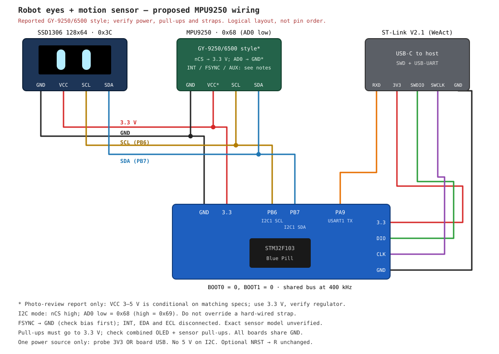

# stm32-test

Grok-inspired animated robot eyes on a 0.96" SSD1306 OLED, driven by an
STM32F103 Blue Pill, written from scratch in C. No HAL, no CMSIS, no Arduino, no display
library, no C library: every register is set by hand from the reference manual.

## What's inside
- Startup code, vector table and linker script
- 72 MHz clock from the 8 MHz crystal (HSE + PLL), HSI fallback
- SysTick timebase: `millis()`, `delay_ms()`, `delay_us()`
- I2C two ways: hardware I2C1 at 400 kHz, or bit-banged GPIO
- DMA + interrupt screen updates (full 1 KB frame in ~23 ms, CPU free meanwhile)
- Robot eyes: smooth left/right glances, blinks and a playful double blink
- SSD1306 driver with a 5x7 ASCII font and clipped text drawing
- USART1 status log over the debugger's USB-UART bridge

## Hardware
| Part | Notes |
|---|---|
| STM32F103 Blue Pill | 64 KB flash, 20 KB RAM, 8 MHz crystal |
| SSD1306 128x64 OLED | 4-pin I2C, address `0x3C` |
| ST-Link V2.1 probe | e.g. WeAct Mini Debugger (SWD + USB-UART) |

### Wiring


The MPU9250 connections are **proposed**, not implemented in firmware yet.
Confirm the breakout's supply pin, logic levels and straps before wiring it;
see [motion-reactive eyes design](docs/mpu9250-motion.md). Initial debugger probing
found the sensor at `0x68` with WHO_AM_I `0x71`; raw readings and remaining
calibration checks are recorded in [bring-up results](docs/mpu9250-bringup.md).

| From | To (Blue Pill) |
|---|---|
| OLED SCL | PB6 |
| OLED SDA | PB7 |
| OLED VCC / GND | 3.3 / GND |
| MPU9250 SCL / SDA (proposed) | PB6 / PB7, shared with OLED |
| MPU9250 supply / GND (proposed) | 3.3 / GND, only after breakout verification |
| Probe 3V3 / SWDIO / SWCLK / GND | 3.3 / DIO / CLK / GND |
| Probe RXD | PA9 (USART1 TX) |

Both BOOT jumpers at 0. Power the board from the probe or USB, not both.

## Build and flash
Requires [Nix](https://nixos.org) with flakes; the dev shell provides the ARM
toolchain, make, OpenOCD and tio.

```sh
direnv allow          # or: nix develop
make flash            # build and program over SWD
tio -b 115200 /dev/cu.usbmodem1102   # watch the log (port name varies)
```

`make I2C=bitbang flash` uses the bit-banged I2C driver instead.
`make openocd` + `make gdb` (two terminals) for debugging.

## Animation
Two bright rounded eyes follow an eight-second loop: blink, look left, look
right, return to center, then double blink. Hardware I2C targets 60 FPS using
16/17/17 ms frame intervals. Each update sends only the eye window (102 columns
by 6 pages = 612 bytes, about 14 ms at 400 kHz), after a full-screen startup
clear. A private 1 KB staging buffer packs page slices for one DMA transfer.
The bit-banged driver skips missed frames but keeps the same animation timing.
Drawing waits for DMA completion. UART logs completed FPS (multiplied by 10),
maximum observed flush duration in ms, frame starts and errors every 4 s.
60 FPS is a target until verified on hardware; the I2C clock stays at 400 kHz.

The pose timeline and eye dimensions live in `src/robot_eyes.c`.

## Status LED (PC13)
- 2 s blink: running, display OK
- fast blink: display error
- off: I2C bus stuck

## Planned motion interaction
An MPU9250 accelerometer on the same prototype breadboard will select between:
- Stationary: current default animation.
- Gentle wobble: squinting eyes.
- Deliberate shake: spinning dizzy spirals replacing both eyes entirely.

Both reactions return to default after **2 continuous seconds of quiet**.
Numeric trigger thresholds and animation details remain to be agreed/tuned;
no motion firmware is included yet.

See [`docs/mpu9250-motion.md`](docs/mpu9250-motion.md) for state transitions,
proposed wiring, shared-I2C timing constraints and implementation milestones.

## More
- `CONTEXT.md`: design notes, register readouts and milestone history
- `AGENTS.md`: layout and coding rules
